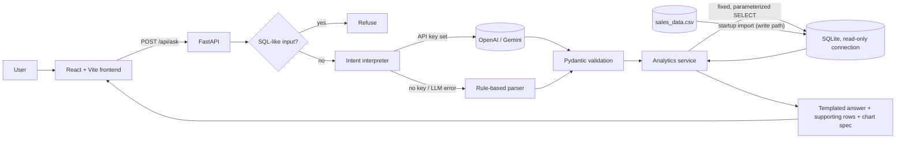

# SalesIQ — Mini AI Business Intelligence Assistant

Ask plain-English questions about a sales transaction dataset and get answers backed by real database queries, with the supporting figures and a chart.

Built for the RSG *AI-Assisted Development Challenge* (Graduate Engineer Trainee selection).

---

## 1. Problem statement

A business user has a CSV of sales transactions and wants answers such as *"What is the total revenue?"* or *"How did revenue change between January and February?"* without writing SQL. The answers must be **correct**, **traceable to the data**, and **safe**: an AI model must not be able to invent numbers or damage the database.

## 2. Objectives

- Load the supplied CSV into SQLite, handling missing, invalid and duplicate records transparently.
- Answer all five required question types (plus useful variations) through an API.
- Use an LLM to interpret questions **when configured**, with a documented deterministic fallback when it is not.
- Show the answer, the detected intent, the interpretation mode, and the supporting figures in a web UI.
- Cover calculations, validation and security boundaries with automated tests.

## 3. Features

| Area | What you get |
|---|---|
| Questions | Total revenue · top/bottom product · monthly trend · top/bottom region · month-vs-month change · revenue by product/region/category/channel · units sold · optional single-month filter ("total revenue in March") |
| AI | OpenAI or Gemini intent extraction (JSON, schema-validated) **or** a rule-based parser; the mode is shown on every answer |
| Dashboard | KPI cards, prominent question box with example questions, monthly line chart, product and region bar charts |
| Pages | Dashboard · Ask AI (session history) · Sales Analytics · Transactions (filter + paginate) · Data Quality · About / Architecture |
| Data quality | Import summary, flagged records, rejected rows with reasons, written cleaning policy |
| Safety | No text-to-SQL; fixed parameterized queries; read-only DB connection with an SQLite authorizer; SQL-like input refused; generic error messages |

## 4. Technology stack

- **Frontend:** React 18, Vite 5, JavaScript, CSS, Recharts, lucide-react, Fetch API
- **Backend:** Python 3.11+ (tested on 3.13), FastAPI, Uvicorn, Pandas, Pydantic v2, `sqlite3`, httpx (LLM REST calls), python-dotenv
- **Database:** SQLite
- **AI:** OpenAI Chat Completions API or Google Gemini API (optional), deterministic fallback parser
- **Testing:** Pytest + FastAPI `TestClient`

## 5. Architecture overview



More detail: [docs/architecture.md](docs/architecture.md).

```
salesiq-ai-bi/
├── backend/
│   ├── app/
│   │   ├── main.py            FastAPI app factory, routes, error handlers, startup import
│   │   ├── config.py          Environment settings, path resolution
│   │   ├── database.py        Schema, eligible_sales view, read-only/write connections
│   │   ├── data_loader.py     CSV → validate → dedupe → SQLite (idempotent, transactional)
│   │   ├── analytics.py       Approved SQL operations (the only place queries live)
│   │   ├── ai_interpreter.py  LLM clients, prompt, JSON validation, fallback parser
│   │   ├── services.py        Question → intent → analytics → answer text
│   │   └── schemas.py         Pydantic models (intents, requests, responses)
│   ├── tests/                 Pytest suite (temporary databases only)
│   ├── data/sales_data.csv    The supplied dataset (unchanged copy)
│   ├── pytest.ini
│   └── requirements.txt
├── frontend/
│   ├── src/{components,pages,services,hooks,utils}, App.jsx, main.jsx, styles.css
│   ├── index.html, vite.config.js, package.json
├── docs/architecture.md, docs/development_notes.md
├── .env.example
└── README.md
```

## 6. Database schema

```sql
sales_transactions (
  transaction_id   TEXT PRIMARY KEY,
  order_date       TEXT NOT NULL,      -- ISO 8601 YYYY-MM-DD
  order_month      TEXT NOT NULL,      -- YYYY-MM (grouping key)
  product, category, region, sales_channel  TEXT NOT NULL,
  quantity         INTEGER NOT NULL CHECK (quantity >= 0),
  unit_price_paise INTEGER NULL CHECK (unit_price_paise >= 0),   -- NULL = unknown
  discount_paise   INTEGER NOT NULL CHECK (discount_paise >= 0),
  status           TEXT NOT NULL,
  quality_flags    TEXT NOT NULL DEFAULT '',                      -- e.g. "zero_quantity"
  source_row       INTEGER NOT NULL
)  -- indexes on order_month, product, region, status

VIEW eligible_sales      -- the single definition of revenue (see §7)
rejected_rows (id, source_row, transaction_id, reason, raw_json)
import_runs   (id, source_file, source_sha256, imported_at, total_rows, imported_rows, rejected_rows, duplicate_rows)
```

Money is stored as **integer paise** (1/100 rupee), so every SUM is exact; values are converted to rupees (2 decimals) only in API responses.

## 7. Revenue definition

```
Net revenue = Quantity × Unit price − Discount amount
```

It is applied to **eligible** transactions only, defined once in the `eligible_sales` SQL view:

- `status = 'Completed'`, **and**
- unit price is known (not NULL), **and**
- the discount does not exceed the gross amount.

The dashboard, every API endpoint, the charts and the tests all read from this view, so they always agree. Ties in rankings are broken alphabetically and reported as ties.

## 8. Data-cleaning policy

What the supplied CSV actually contains (51 rows, `DD-MM-YYYY` dates, 10 columns):

| Finding | Rows | Treatment |
|---|---|---|
| `Status = Returned` | TXN0033 | Stored, flagged, **excluded** from revenue. It was never counted, so nothing is subtracted a second time. |
| `Quantity = 0` | TXN0034 | Stored, flagged, **counted** with ₹0 revenue (it is a valid number, not a missing one). |
| Blank `Unit_price` | TXN0051 | Stored with price `NULL` (**never** replaced by 0), flagged, **excluded** from revenue. |
| Duplicate IDs, invalid dates, negative/non-numeric numbers | none in this file | Handled by the loader; tested with a fixture. |

General rules applied by `data_loader.py`:

| Condition | Result |
|---|---|
| Missing ID/date/product/category/region/channel/status/quantity/discount | Rejected (reason recorded) |
| Date not a real `DD-MM-YYYY` date (e.g. `31-02-2026`) | Rejected |
| Non-numeric, fractional or negative quantity; non-numeric or negative price/discount | Rejected |
| Repeated transaction ID | First occurrence kept, later rows rejected as `duplicate` |
| Status other than Completed/Returned/Cancelled/Pending | Stored, flagged `unknown_status`, excluded |
| Discount > quantity × price | Stored, flagged, excluded |

All CSV columns are read as text (`dtype=str`, `keep_default_na=False`) so pandas cannot silently turn a blank into `NaN` or `0`. Statuses are whitespace-trimmed and title-cased.

**Results on the supplied data** (verified by running the app and the test suite; computed by queries, not hardcoded): 51 rows imported, 0 rejected, 0 duplicates; **49 eligible transactions**, **633 units**, gross ₹14,43,700 − discounts ₹4,500 = **net revenue ₹14,39,200**. Top product **Monitor** (₹4,73,000); top region **South** (₹4,11,200). Monthly: Jan ₹2,10,250 · Feb ₹2,34,600 · Mar ₹2,23,900 · Apr ₹2,40,700 · May ₹3,18,500 · Jun ₹2,11,250.

## 9. Supported questions

| Intent | Example phrasings |
|---|---|
| `total_revenue` | What is the total revenue? · How much revenue did we generate? · Total revenue in March |
| `top_product` / `bottom_product` | Which product generated the highest revenue? · Which products generated the least revenue? |
| `monthly_revenue` | What is the monthly revenue trend? · Show me the monthly sales trend. |
| `top_region` / `bottom_region` | Which region generated the highest sales? · Which region performs best? · Which is the worst region? |
| `compare_months` | Compare January and February 2026. · What was the revenue growth between March and April? |
| `product_breakdown` / `region_breakdown` | Show me sales by product. · Show revenue by region. |
| `category_breakdown` / `channel_breakdown` | Revenue by category · Online vs retail sales |
| `total_units` | How many units did we sell? · How many units did we sell in May? |
| `unsupported` | Profit, costs, customers, forecasts, unrelated topics, two dimensions at once, SQL commands → a clarification, no numbers |

Month handling: a month without a year takes the year written elsewhere in the question; otherwise it is resolved from the data **only if it exists in exactly one year**, and the answer says so ("assumed 2026"). Ambiguous months, months without data and identical months are rejected with an explanation. "May I…" is not mistaken for the month May.

## 10. API

| Method | Path | Purpose |
|---|---|---|
| GET | `/api/health` | App status, DB connectivity, data loaded, AI mode/provider/model |
| GET | `/api/summary` | KPIs, top product/region, date range, data-quality summary |
| POST | `/api/ask` | `{ "question": "..." }` → structured answer |
| GET | `/api/analytics/monthly` | Monthly revenue with month-over-month change |
| GET | `/api/analytics/products` · `/regions` · `/categories` · `/channels` | Revenue breakdowns |
| GET | `/api/data-quality` | Import counts, issue counts, flagged and rejected records |
| GET | `/api/transactions?page=1&page_size=20&product=&region=&category=&channel=&status=` | Paginated, filterable, read-only list |
| GET | `/api/transactions/filters` | Distinct values for the filter dropdowns |

Interactive docs: http://localhost:8000/docs

**Example**

```bash
curl -X POST http://localhost:8000/api/ask -H "Content-Type: application/json" -d "{\"question\": \"Compare January and February 2026\"}"
```

```json
{
  "success": true,
  "question": "Compare January and February 2026",
  "intent": "compare_months",
  "answer": "Revenue increased from ₹2,10,250.00 in January 2026 to ₹2,34,600.00 in February 2026, a change of +₹24,350.00 (+11.58%).",
  "unit": "INR",
  "value": 24350.0,
  "supporting_data": [
    {"month": "2026-01", "revenue": 210250.0, "transactions": 8},
    {"month": "2026-02", "revenue": 234600.0, "transactions": 8},
    {"month": "Change", "revenue": 24350.0, "change_pct": 11.58}
  ],
  "chart": {"type": "bar", "x_key": "month", "y_key": "revenue", "title": "January 2026 vs February 2026"},
  "metadata": {
    "source": "sqlite", "ai_mode": "fallback", "ai_provider": null, "ai_model": null,
    "filters": {"status": "Completed", "unit_price": "known", "first_month": "2026-01", "second_month": "2026-02"},
    "row_count": 3, "notes": []
  }
}
```

Unsupported question → HTTP 200 with `"success": false, "intent": "unsupported"` and a clarification in `answer`. Empty or over-long question → HTTP 422 `{"success": false, "error": "Invalid request", "details": [...]}`. Database failure → HTTP 503 with a generic message. Any other failure → HTTP 500 with a generic message (details only in the server log).

## 11. Setup (Windows)

Prerequisites: **Python 3.11+** and **Node.js 18+** on your PATH (`python --version`, `node --version`).

### Backend

```powershell
cd backend
python -m venv .venv
.venv\Scripts\activate
pip install -r requirements.txt
uvicorn app.main:app --reload --port 8000
```

On first start the backend creates `backend/data/salesiq.db` and imports the CSV automatically. Later starts skip the import if the CSV is unchanged (SHA-256 check). No manual table creation is needed.

Optional, explicit re-import (wipes and reloads in one transaction):

```powershell
python -m app.data_loader --reload
```

### Frontend (second terminal)

```powershell
cd frontend
npm install
npm run dev
```

Open http://localhost:5173. The frontend calls `http://localhost:8000` by default; override with `VITE_API_BASE_URL` in `frontend/.env`.

### Environment variables

Copy `.env.example` to `.env` in the project root (optional — everything works without it).

| Variable | Default | Purpose |
|---|---|---|
| `LLM_PROVIDER` | `none` | `none`, `openai` or `gemini` |
| `LLM_API_KEY` | empty | Provider API key. Empty → fallback parser |
| `LLM_MODEL` | `gpt-4o-mini` / `gemini-2.5-flash` | Model name |
| `LLM_BASE_URL` | provider default | OpenAI-compatible endpoint (e.g. local Ollama `http://localhost:11434/v1`) |
| `LLM_TIMEOUT_SECONDS` | `15` | LLM request timeout |
| `DATABASE_PATH` | `data/salesiq.db` | Relative to `backend/` |
| `CSV_PATH` | `data/sales_data.csv` | Relative to `backend/` |
| `CORS_ORIGINS` | `http://localhost:5173,http://127.0.0.1:5173` | Allowed frontend origins |
| `VITE_API_BASE_URL` | `http://localhost:8000` | Backend URL used by the frontend |

**Enable LLM mode:** set `LLM_PROVIDER=openai` (or `gemini`) and `LLM_API_KEY=...` in `.env`, restart the backend. The header then shows "LLM: <model>" and each answer is tagged "LLM". An invalid key or provider outage falls back to the parser and is tagged "Rule-based (LLM failed)".

## 12. Running the tests

```powershell
cd backend
.venv\Scripts\activate
python -m pytest
```

The suite uses temporary databases created from a small fixture CSV (plus a read-only copy of the real CSV for one cross-check). It never touches `backend/data/salesiq.db` and needs no API key — the LLM is replaced by a fake client.

| File | What it proves |
|---|---|
| `test_data_loader.py` | Valid import counts; duplicates keep first occurrence; missing price stored as NULL and excluded; invalid rows rejected with reasons; idempotent re-import; missing columns rejected; **real-CSV total equals an independent `csv` + `Decimal` calculation** |
| `test_analytics.py` | Total revenue; top/bottom product; top region; chronological monthly grouping; absolute and % change; zero previous month → no division by zero; invalid month parameters (format, injection string, same month, no data); alphabetical tie-break; read-only connection refuses DROP/DELETE/UPDATE/INSERT/ATTACH |
| `test_interpreter.py` | 15 phrasings map to the right intent; month/year extraction; ambiguous year → clarification; unsupported topics; "May I…"; valid LLM output used and labelled `llm`; malformed/unknown/unsafe LLM output and network failure → safe fallback |
| `test_api.py` | Health; summary schema/values; ask schema; empty/missing/too-long question → 422; unsupported question; SQL injection attempts leave the DB unchanged; DB error and unexpected error return generic messages without internals; analytics, transactions (pagination and validation) and data-quality endpoints |

Last run: **76 passed** (`python -m pytest`, Python 3.13, Windows 11).

## 13. AI integration design

1. The question is first screened for SQL-like content (`DROP TABLE`, `;`, `UNION SELECT`, …); such input is refused.
2. **LLM mode:** the model receives a system prompt listing the allowed intents, their parameters, the months present in the data and the rules, and must return one JSON object (`response_format=json_object` for OpenAI, `responseMimeType=application/json` for Gemini, temperature 0). The reply is parsed (code fences tolerated) and validated by Pydantic: unknown intents, extra parameters (e.g. `"sql"`), malformed months or a comparison without two months are **rejected**, and the request falls back to the parser.
3. **Fallback mode:** keyword groups and a month-name extractor implement the same intent schema. It declines anything it does not recognise rather than guessing, and it refuses topics the data cannot answer (profit, cost, customers, forecasts).
4. The validated intent selects one function in `analytics.py`, which runs a fixed, parameterized query on the read-only connection.
5. The answer text is built from the query result with templates. **The LLM never produces numbers or prose shown to the user**, so it cannot hallucinate figures.

The UI and every response state which interpreter was used (`metadata.ai_mode` = `llm` | `fallback` | `fallback_after_llm_error`).

## 14. Security precautions

- **No text-to-SQL.** SQL lives only in `analytics.py`; user values are bound parameters; the only dynamic SQL fragment (GROUP BY column) comes from a hard-coded allowlist.
- **Read-only analytics connection:** `mode=ro` URI + `PRAGMA query_only=ON` + an SQLite authorizer that denies every action except SELECT/READ/FUNCTION. Tests show DROP, DELETE, UPDATE, INSERT and ATTACH fail on it.
- **Separate write path** used only by the CSV loader, in a single transaction (all-or-nothing).
- Requests validated by Pydantic (question 1–500 chars; page/page_size bounds; filter length limits).
- Generic error responses; stack traces and exception text stay in server logs. API keys are read from the environment, never logged or returned, and sent in headers (not URLs).
- CORS limited to the local frontend origins and to GET/POST.
- `.env` and the generated database are git-ignored.

## 15. Known limitations

- The LLM path is covered by tests with a **mocked** client only; it has not been exercised against a live OpenAI/Gemini account in this repository's verification. Model names in `.env.example` may need updating as providers retire models.
- The rule-based parser handles the documented phrasings and close variants, not arbitrary language. One analysis dimension per question (no "top product in the North region").
- Filters are limited to a single month; no date ranges, quarters or years-to-date.
- Revenue is reported in INR with no currency conversion; the CSV is assumed to be single-currency.
- Policy choices (e.g. counting a zero-quantity completed order as an eligible transaction) are documented assumptions, not business-confirmed rules.
- Recharts 2.x is used for its stable API; npm prints a deprecation notice recommending v3.
- The Ask AI history is held in browser memory and is lost on page refresh.

## 16. Future improvements

- Optional filters across dimensions (product × region × month) via a richer, still validated, intent schema.
- Validated text-to-SQL for ad-hoc questions using a SQL parser (e.g. `sqlglot`) with table/column allowlists, kept off by default.
- LLM-written narrative summaries constrained to the returned numbers, with a numeric consistency check.
- Upload-a-CSV flow with a preview of rejected rows before committing.
- CI pipeline (GitHub Actions) running pytest and a frontend build; Playwright UI tests.
