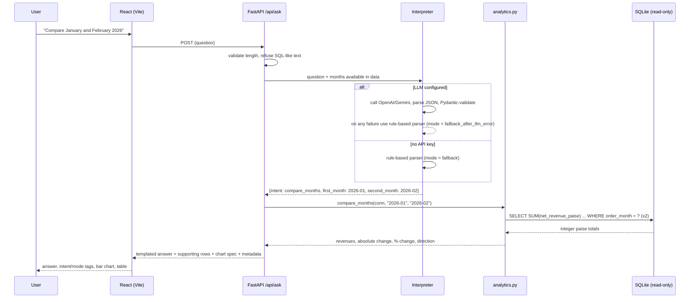

# SalesIQ architecture

## 1. Question flow

```
User
  -> React frontend            (AskPanel -> services/api.js: POST /api/ask)
  -> FastAPI question endpoint (main.py: Pydantic AskRequest, 1–500 chars)
  -> Input guard               (services.py: refuse SQL-like text)
  -> AI intent interpreter     (ai_interpreter.py: LLM or rule-based parser)
  -> Intent validation         (schemas.py: InterpretedQuestion / IntentParameters)
  -> Analytics service         (services.py -> analytics.py, one function per intent)
  -> SQLite read-only query    (database.py: read_connection + authorizer)
  -> Structured result         (AskResponse: answer, value, supporting_data, chart, metadata)
  -> Frontend answer and visualization (AnswerCard: text, tags, Recharts chart, table)
```



### Why this design

- **The AI chooses, the database computes.** The model's only job is to pick one of 12 approved intents and fill in month parameters. It never writes SQL and never produces the numbers or answer text, so it cannot hallucinate figures or run destructive statements.
- **Two independent safety layers on the database.** (1) Only predefined, parameterized queries exist; (2) the connection itself is read-only and an SQLite authorizer denies anything except reads, so even a coding mistake could not write through it.
- **One revenue definition.** The `eligible_sales` view encodes the business rule once; every endpoint and test uses it.
- **Fallback is explicit.** If no key is configured or the LLM fails, a deterministic parser handles the documented question shapes, and the response says which path was used.

## 2. Module responsibilities

| Module | Responsibility |
|---|---|
| `config.py` | Reads env vars / `.env`, resolves paths relative to `backend/`, validates the LLM provider (unknown provider or missing key → fallback, never a crash) |
| `database.py` | Schema DDL, `eligible_sales` view, `write_connection` (transactional), `read_connection` (read-only + authorizer), `fetch_all/fetch_one`, health check |
| `data_loader.py` | CSV import pipeline (below); CLI `python -m app.data_loader [--reload]` |
| `analytics.py` | All SQL: totals, breakdowns, rankings with ties, monthly trend with gap filling, month comparison, data-quality report, transaction listing |
| `ai_interpreter.py` | Month extraction, rule-based parser, OpenAI/Gemini REST clients, system prompt, JSON extraction + validation, mode selection |
| `services.py` | SQL-like input guard, intent → analytic dispatch, answer templates, INR formatting, summary payload |
| `schemas.py` | Pydantic models: `IntentName`, `IntentParameters`, `InterpretedQuestion`, `AskRequest`, `AskResponse`, `HealthResponse` |
| `main.py` | App factory (`create_app(settings, llm_client)` for tests), startup import, CORS, routes, exception handlers |

## 3. CSV import and validation pipeline

```
sales_data.csv
  │  SHA-256 matches last import_runs row and data present? ──yes──> skip (idempotent)
  ▼
pandas.read_csv(dtype=str, keep_default_na=False)      # no silent NaN/0 coercion
  ▼
normalise headers ("Transaction_Id" -> "transaction_id") and require all 10 columns
  ▼
for each row (1-based data row number):
    trim text; parse date strictly as DD-MM-YYYY -> ISO date + YYYY-MM
    quantity: required, whole number, >= 0
    unit price: blank -> NULL + flag "missing_unit_price"; else Decimal -> paise, >= 0
    discount: required, Decimal -> paise, >= 0
    status: trimmed + title-cased; Returned -> flag; unknown -> flag
    flags: zero_quantity, discount_exceeds_gross
    duplicate ID -> reject (first occurrence wins)
    any hard failure -> rejected_rows (reason + raw JSON)
  ▼
ONE transaction: DELETE old rows -> INSERT valid rows -> INSERT rejected rows -> INSERT import_runs
  (any exception rolls everything back; the previous data stays intact)
  ▼
summary {total_rows, imported_rows, rejected_rows, duplicate_rows, skipped}
```

Rejected rows never reach `sales_transactions`. Flagged rows are stored (so the Transactions and Data Quality pages can show them) but only rows passing the `eligible_sales` view count toward revenue.

## 4. Frontend structure

| Folder | Contents |
|---|---|
| `services/api.js` | Single fetch wrapper, base URL from `VITE_API_BASE_URL`, friendly network/API errors |
| `hooks/useApi.js` | `useApi` (loading/error/data/reload) and a tiny hash router (`#/analytics` survives refresh) |
| `components/` | Sidebar, Header (DB/AI/date-range pills + refresh), StatCard, AskPanel, AnswerCard, Charts (Recharts), ChartCard, DataTable, States (loading/empty/error/skeleton) |
| `pages/` | Dashboard, Ask AI, Sales Analytics, Transactions, Data Quality, About |
| `utils/format.js` | INR/number/percent/month formatting that never renders `NaN`, `Infinity` or `undefined` |

All figures shown come from API responses; there is no mock data in the frontend.
